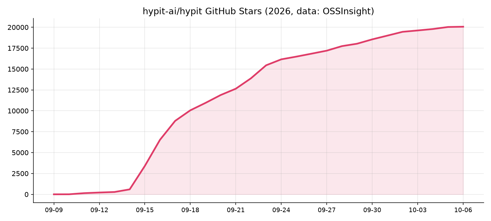
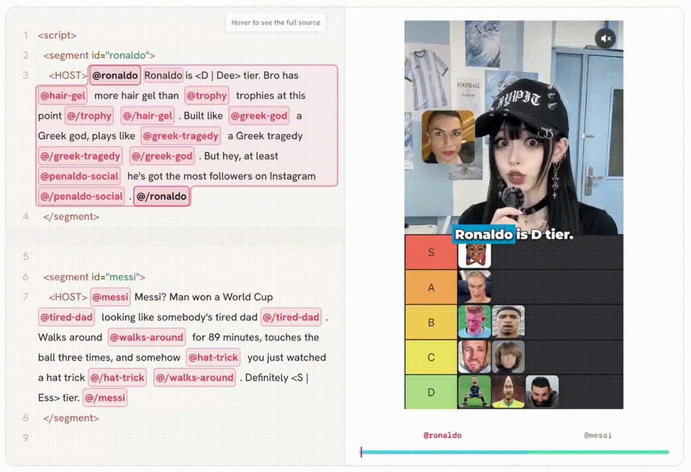
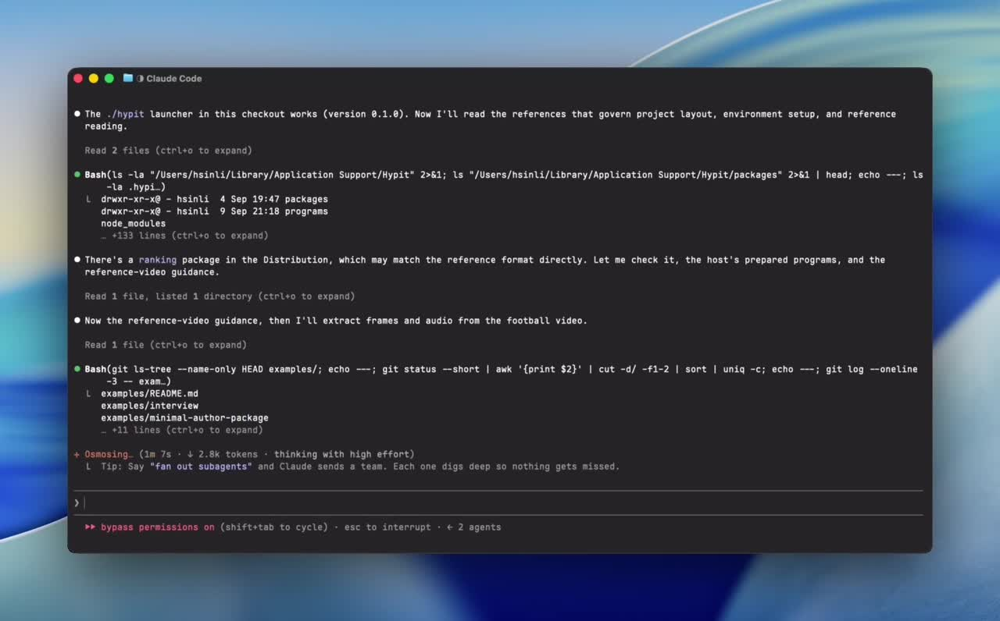
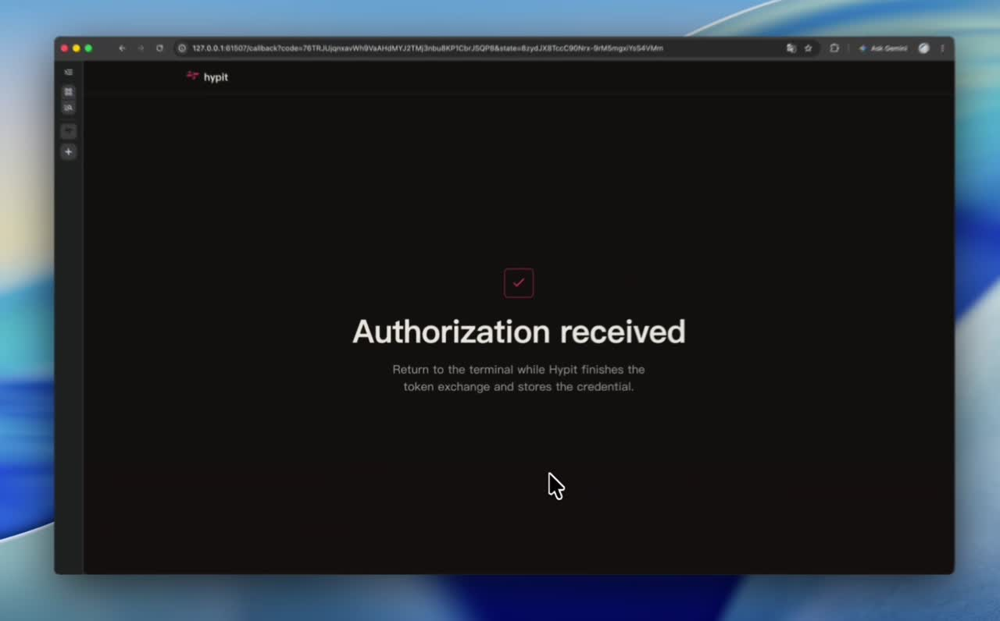
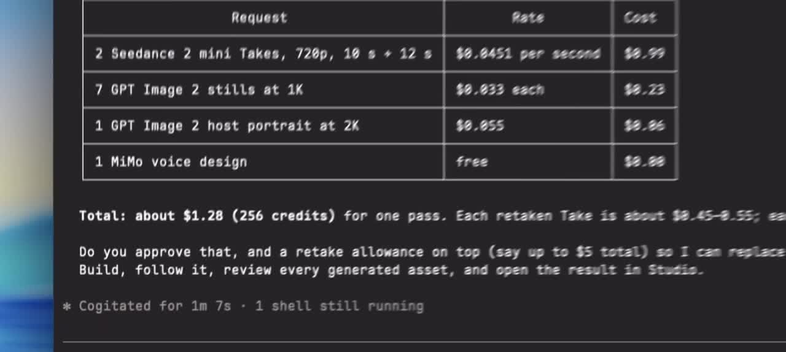
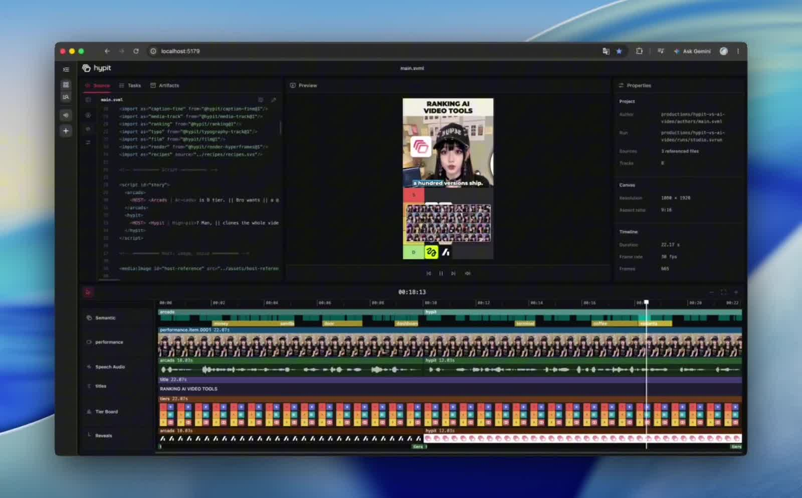

> 在线阅读（GitHub Pages）：https://maynor996.github.io/hypit-viral-video/

# 1.9 万 Star 的 Hypit：让 AI Agent 帮你“一键复刻”爆款视频，保姆级上手教程

最近 GitHub 上有个项目火得离谱：**Hypit** 。7 月底才建仓，9 月中旬突然爆发，单日涨了 3000 多 Star，冲上 Trendshift 全语言日榜第一，现在已经接近 2 万 Star。

  
_hypit 的 Star 增长曲线：9 月 15 日前后爆发（数据来源：OSSInsight）_

它的口号很直接：**“让 AI Agent 复刻任何爆款视频。一条命令，100 个变体。”**

热度有多高？已经有人在闲鱼卖“Hypit 资料包”，95 块一份；代部署从 9.9 到 100 元不等。其实官方文档写得很清楚，安装只要一条命令。这篇把它是什么、怎么装、怎么用、花多少钱、有哪些坑一次讲完，省下这笔钱。

* * *

### 一、Hypit 到底是什么？

一句话：**Hypit 是给 Claude Code、Codex 这类编程 Agent 用的“做视频技能包”。**

注意，它**不是** 一个网页版剪辑工具，也不是剪映那种 App。它由两部分组成：

  * **Skill（技能）** ：装进你的 Coding Agent，教 Agent 怎么拆解视频、怎么写视频工作流；
  * **`hypit` 命令行程序**：真正干活的工具，负责生成素材、对齐字幕、渲染成片。

你给 Agent 一条参考视频，再说清楚想怎么改，Agent 会：

  1. 拆解原片：画面、字幕、B-roll、特效、节奏；
  2. 把这些写成一份**可编辑的工作流文件** （官方叫 SVML），所有画面和字幕都**锚定在“词”上，而不是秒上** ；
  3. 调用图片、视频、配音模型生成新素材；
  4. 用无头浏览器 + ffmpeg 渲染出 mp4。

  
_左边是 SVML 工作流源文件，右边是对应的视频画面，字幕和图形都锚定在词上（图源：Hypit 官方 README）_

最大的不同在于：你拿到的不只是一个成片，而是一份**能反复改、反复跑的工程** 。想换主播、换产品、换语言、换画幅，改几句话重跑就行，这就是“一份工作流，100 个变体”的意思。

* * *

### 二、它能做哪些视频？

官方 README 里列的场景，基本覆盖了短视频和投流的主流玩法：

  * **信息流广告** ：从广告库扒一条正在跑的广告，克隆成工作流，换成你的产品，一天出几十个不同开头（Hook）的版本；
  * **复刻爆款** ：TikTok、Reels、Shorts 上的爆款都能变成模板；
  * **带货视频** ：跑通一个格式后，每天换一个 SKU、价格、CTA；
  * **AI UGC 和口播** ：配音、逐词字幕、B-roll、卡点剪辑自动挂好；
  * **播客、采访切片** ：分屏、区分说话人的字幕、反应特效；
  * **纯代码渲染的视频** ：字幕、动效全靠前端代码画，**不调用生成模型，可以零 API 费用** ；
  * **多语言版本** ：同一条视频出十种语言，改一句台词，时间轴自动重排。

官方给了三个示例，每个都附了真实成本：

示例| 内容| 用到的模型| 总成本  
---|---|---|---  
足球排行榜| 20 秒 Tier List，3 个复刻版本| Seedance 2 Mini + GPT Image 2 + WhisperX| **$1.15**  
播客片段| 18 秒肌酸带货播客，换成 3 个广告品类| 同上| **$1.07**  
街头采访| 26 秒街采，含西班牙语版本| 同上 + 人脸检测| **$1.09**  
  
> 注意：这里的成本**不含 Coding Agent 本身的模型费用** （比如 Claude Code 消耗的 token）。

* * *

### 三、安装：真的只要一条命令

#### 你需要准备

  * 一个支持 Skill 的 Coding Agent，比如 **Claude Code** 或 **Codex** ；
  * 一条参考视频（本地文件或支持的平台链接），或者一段对目标视频的描述；
  * 生成模型的账户：用官方托管的 HypiHub，或者用你自己的 API Key。

如果 Agent 需要帮你把 `hypit` 程序装在本机，环境要求是 **Node.js 22.15+** ，另外会用到 pnpm、ffmpeg 和 Chromium。不过一般不用你手动装，Agent 会检查并协助安装。

#### 安装 Skill

在终端执行：
    
    
    npx skills add hypit-ai/hypit -g
    

就这一条。**不需要克隆 Hypit 仓库。** 首次使用时，Agent 会检查有没有 `hypit` 程序，缺什么会帮你装。

已经装过的，可以让 Agent 用这条命令检查版本：
    
    
    hypit version --check
    

* * *

### 四、上手：复刻你的第一条视频

#### 第 1 步：在 Agent 里调用 `/hypit`

打开 Claude Code 或 Codex，在任意空目录或项目目录开一个会话，输入：
    
    
    /hypit 复刻这个视频：/path/to/video.mp4，把产品换成我的 XXX，保留抓人的开场和排行榜的呈现方式。
    

也可以附上人物照片、产品图、品牌素材。人物、产品、语言、画幅、行动号召都能改。

没有参考视频也行，直接描述：
    
    
    /hypit 做一个 ranking 视频，把我的产品排到 S 级。
    

  
_在 Claude Code 里，Agent 读取参考视频、拆解结构（图源：Hypit 官方快速开始演示视频截图）_

#### 第 2 步：选模型服务

Agent 会先检查环境。有对白的视频需要 **WhisperX** 做逐词对齐，本地跑比较吃 GPU，所以有两种选择：

  * **HypiHub（官方托管）** ：一个账户搞定 WhisperX、图片、视频、配音模型，最省事；
  * **自带 Key** ：告诉 Agent 你用的是哪家服务、给它接口文档，它会自己写好对接。官方合作的聚合平台有 HiAPI、Pollo API、Monid、TokenDance 等，也可以用你自己的渠道。

  
_登录 HypiHub 授权完成后，回到终端继续（图源：Hypit 官方快速开始演示视频截图）_

#### 第 3 步：确认报价，开始制作

这一步设计得很贴心：**花钱之前，Agent 会先告诉你用哪个账户、准备生成什么、预计多少钱。** 你确认预算后它才开始连续调用：
    
    
    用我的 HypiHub 账户完成这条视频，按我们确认的预算推进，开始吧。
    

  
_Agent 在生成前列出每项调用的单价和总价，这一条约 $1.28（图源：Hypit 官方快速开始演示视频截图）_

等生成的时候，Agent 会同时做字幕和图形，进度随时汇报。

#### 第 4 步：看成片，继续改

成片出来后，Agent 会自己检查版面、字幕、B-roll 的时机。你也可以打开 **Studio** 看时间线、调属性。

  
_Hypit Studio：左侧源码、中间预览、下方时间线（图源：Hypit 官方快速开始演示视频截图）_

想改哪里，继续跟它说就行：“把主播换成猫”、“翻译成英文”、“开头换成反问句”。**能复用的素材会继续用，不会重新花钱生成。** 项目都存在普通文件里，随时可以接着改。

* * *

### 五、花多少钱？

  * **Hypit 本身** ：免费开源，不按人头、不按渲染次数收费，**不加水印** ；
  * **生成模型** ：按你选的服务商计费，官方示例每条 20 秒左右的视频约 **$1.1** ；
  * **Coding Agent** ：Claude Code、Codex 的订阅或 token 费另算，复杂视频 Agent 会来回跑很多轮，这块别忽略；
  * **零成本玩法** ：只做字幕、动效、代码渲染画面，不调生成模型，基本不花 API 费。

* * *

### 六、几个坑，提前知道

  1. **它不是傻瓜工具** ：前提是你会用 Claude Code、Codex 这类命令行 Agent。完全没接触过的话，先花半小时熟悉 Agent 基本操作。
  2. **本地部署有门槛** ：WhisperX 本地跑最好有 GPU，没有就用托管服务。
  3. **中文字幕要多检查** ：有第三方测评反馈，中文场景下字幕偶尔会丢，出片后自己过一遍。
  4. **许可证有限制** ：Hypit 用的是“Apache 2.0 + 附加条款”。**自己用、商用、给客户做视频都可以** ；但**未经书面授权，不能拿它做多租户的 SaaS 或托管服务** ，也不能做商业再分发，CLI 里的 LOGO 和版权信息不能去掉。想“套个壳做网站卖会员”的，这条要注意。
  5. **复刻 ≠ 搬运** ：它复刻的是爆款的**结构** （节奏、开场、字幕、版式），内容要换成你自己的。直接照搬别人的人物、素材和台词，既有版权风险，也容易被平台判定为搬运。

* * *

### 七、适合谁用？

  * **投流、做广告的** ：一条跑通的素材快速裂变几十个 Hook 版本，这是 Hypit 最值钱的场景；
  * **电商、带货的** ：一个模板每天换 SKU；
  * **做 AI 内容账号的** ：批量做排行榜、播客切片、街采类短视频；
  * **出海做多语言的** ：同一条视频一键多语言版本。

如果你只是偶尔剪个 vlog，剪映可能更顺手；但如果你需要**批量、可复用、能迭代** 地做视频，Hypit 值得花一个下午试试。

* * *

### 相关链接

  * GitHub：hypit-ai/hypit（github.com/hypit-ai/hypit）
  * 官方快速开始：hypit.ai/zh/quickstart
  * 模型与 Provider 接入：hypit.ai/zh/guide/providers

* * *

### 体验入口

玩 Hypit 绕不开大模型。Agent 要靠模型来理解视频、写脚本，跑一条视频往往要来回调用很多轮。

  * **TryAllAPI（tryallapi.com）** ：OpenAI 兼容的多模型 API 聚合，一个 Key 用 GPT-6.1 等主流模型，baseURL 填 `https://tryallapi.com/v1` 就能接入支持自定义接口的 Agent 和工具；
  * **TryGPT（trygpt.asia）** ：网页版 GPT / Gemini / Grok，不用折腾环境，先用它把视频脚本和 Hook 想清楚，再交给 Hypit 批量生产。

觉得有用的话点个赞、收藏，下一篇写一个实际复刻案例的全过程。